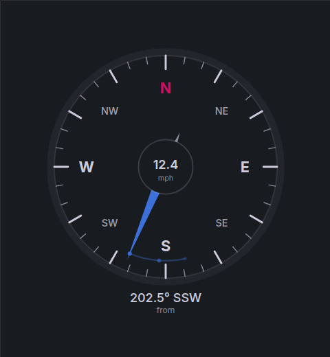

# Compass panel

`springfield-compass-panel` is a Grafana panel plugin that draws a wind-direction compass. The needle rotates to the latest value of a numeric field and takes the short way around the dial, so 359° to 1° passes through north.

It is aimed at a Particle Photon weather station that exports Prometheus metrics:

- `wind_direction_degrees` — 0–360, meteorological direction the wind comes **from**
- `wind_speed_miles_per_hour`

Built-in gauge and Canvas panels can show the number, but they cannot spin a needle smoothly by that value. This panel does.



## What the panel shows

- An SVG compass that scales with the panel: N, E, S, W, and NE, SE, SW, NW, with ticks every 10° and longer ticks every 30°.
- A needle eased to the latest numeric sample. The animation uses the shortest rotation.
- The bearing in degrees and the 16-point name (for example `202.5° SSW`).
- An optional speed readout in the hub, formatted with the field's Grafana unit when one is set.
- An optional trail of earlier directions in the dashboard time range (faded dots and short arcs).
- Colors from the active Grafana theme.

### Panel options

| Option               | Purpose                                                                                                                            |
| -------------------- | ---------------------------------------------------------------------------------------------------------------------------------- |
| Direction field      | Numeric degrees. Leave empty to use the first numeric field.                                                                       |
| Speed field          | Optional. Leave empty to hide the hub readout.                                                                                     |
| Needle points        | **Where the wind comes from** (default) or **where the wind blows to** (opposite direction). The text still shows the field value. |
| Show direction trail | Faded marks for samples in the current time range.                                                                                 |

Null and non-numeric samples are skipped. If the latest finite sample is missing, the dial stays up and the readout says **No data**. A finite value outside 0–360 (360 itself counts as north) hides the needle and says **Out of range**. An empty query uses Grafana's standard no-data state.

## Install on Docker Grafana

The plugin is unsigned. Grafana OSS 13.0.2 will load it when the plugin id is allow-listed.

1. Download `springfield-compass-panel-1.0.0.zip` from the GitHub Release for tag `v1.0.0` (the release workflow creates a **draft** release and attaches the zip). Publishing the draft makes the zip public. You can also download the zip artifact from a successful CI run on `main`.
2. Unzip it. The archive contains a directory named `springfield-compass-panel`.
3. Mount that directory and allow the unsigned plugin:

```yaml
services:
  grafana:
    image: grafana/grafana-oss:13.0.2
    ports:
      - '3000:3000'
    environment:
      GF_PLUGINS_ALLOW_LOADING_UNSIGNED_PLUGINS: springfield-compass-panel
    volumes:
      - ./springfield-compass-panel:/var/lib/grafana/plugins/springfield-compass-panel
```

Restart Grafana, then add a visualization and choose **Compass**.

`grafanaDependency` is `>=12.3.0`. That is the floor from the [Grafana 12.x to 13.x migration](https://grafana.com/developers/plugin-tools/migration-guides/update-from-grafana-versions/migrate-12_x-to-13_x): `react` and `react/jsx-runtime` are webpack externals, so the panel uses Grafana's React 19 runtime and does not bundle its own.

## Example queries

Use a Prometheus datasource and a **range** query if you want the trail (an instant query is only one point). For a single station:

```promql
wind_direction_degrees
```

```promql
wind_speed_miles_per_hour
```

If several series share the metric, aggregate first:

```promql
max(wind_direction_degrees)
```

```promql
max(wind_speed_miles_per_hour)
```

Set **Direction field** to `wind_direction_degrees` and **Speed field** to `wind_speed_miles_per_hour`. Set the speed field's unit to miles per hour if you want the hub to show `mph`.

## Development

Requires Node.js 22.

```bash
npm install
npm run test:ci
npm run typecheck
npm run lint
npm run build
```

`npm run server` starts Grafana OSS 13.0.2 with the plugin mounted and unsigned loading enabled. Override with `GRAFANA_IMAGE` and `GRAFANA_VERSION`.

The production bundle is written to `dist/`. A tag `v*` that matches `package.json` (`v1.0.0` for `1.0.0`) runs [`.github/workflows/release.yml`](https://github.com/springfield-tools/grafana-compass-panel/blob/main/.github/workflows/release.yml), which builds the plugin and attaches the zip to a draft GitHub Release. Pull requests run [`.github/workflows/ci.yml`](https://github.com/springfield-tools/grafana-compass-panel/blob/main/.github/workflows/ci.yml) (typecheck, lint, unit tests, production build, zip artifact).

## Why a custom panel

See [docs/adr/0001-custom-compass-panel.md](https://github.com/springfield-tools/grafana-compass-panel/blob/main/docs/adr/0001-custom-compass-panel.md).
